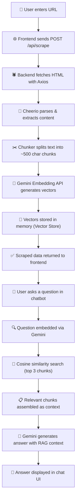

# 🕸️ Assignment 3 — AI-Integrated Web Scraper with RAG Chatbot

> **Course:** Web Systems and Techniques — BS(IT) 4A  
> **University:** Bahria University, Islamabad Campus  
> **CLO:** CLO 3  

---

## 📋 Project Overview

**Project Name:** *WebMind — Chat with Any Website*

Build a full-stack web scraping application where users can paste **any website URL**, the system scrapes and parses its content, displays the extracted data in an organized UI, and powers an **AI chatbot** that answers questions about the scraped content using a **RAG (Retrieval-Augmented Generation)** pipeline with the **Gemini API**.

### 🏆 What Makes This Unique (The "Difficult Part")

> **Dynamic RAG Pipeline:** Instead of hardcoding a single website, the system scrapes *any* user-provided URL on-the-fly, intelligently **chunks** the content, generates **vector embeddings** using the Gemini Embedding API, stores them in-memory, and performs **semantic search** to retrieve only the most relevant chunks before sending them to Gemini for answer generation. This is a production-grade RAG pattern — not a simple "paste everything into a prompt."

---

## 🛠️ Technology Stack

| Layer | Technology | Purpose |
|-------|-----------|---------|
| **Frontend** | React.js (Vite) | Modern responsive UI |
| **Backend** | Node.js + Express.js | API server |
| **Scraping** | Cheerio + Axios | HTML parsing & HTTP requests |
| **AI / LLM** | Google Gemini API (free tier) | Chat responses + text embeddings |
| **RAG Store** | In-memory vector store (custom) | Cosine similarity search on embeddings |
| **Styling** | Tailwind CSS | Clean, responsive design |

---

## 📁 Final Project Structure

```
AI-Integrated-Web-Scraper/
├── server/                    # Backend (Node.js + Express)
│   ├── package.json
│   ├── .env                   # GEMINI_API_KEY stored here
│   ├── server.js              # Express app entry point
│   ├── routes/
│   │   ├── scrape.js          # POST /api/scrape — scrape a URL
│   │   └── chat.js            # POST /api/chat — RAG chatbot
│   ├── services/
│   │   ├── scraper.js         # Cheerio-based scraping logic
│   │   ├── chunker.js         # Text chunking (the smart part)
│   │   ├── embeddings.js      # Gemini embedding API calls
│   │   └── vectorStore.js     # In-memory vector store + cosine similarity
│   └── utils/
│       └── textCleaner.js     # Strip HTML noise, normalize whitespace
│
├── client/                    # Frontend (React + Vite)
│   ├── package.json
│   ├── vite.config.js
│   ├── index.html
│   ├── src/
│   │   ├── App.jsx            # Main app layout
│   │   ├── main.jsx           # Entry point
│   │   ├── components/
│   │   │   ├── Navbar.jsx
│   │   │   ├── UrlInput.jsx       # URL input + scrape button
│   │   │   ├── ScrapedData.jsx    # Display extracted data
│   │   │   ├── ChatBot.jsx        # Chat interface
│   │   │   ├── ChatMessage.jsx    # Single chat bubble
│   │   │   └── LoadingSpinner.jsx
│   │   ├── pages/
│   │   │   ├── Home.jsx
│   │   │   └── About.jsx
│   │   └── styles/
│   │       └── index.css      # Tailwind imports
│   └── public/
│       └── favicon.ico
│
└── README.md
```

---

## 🚀 Step-by-Step Implementation Plan

> Each step builds on the previous one. Complete them **in order**.

---

### Step 1 — Project Initialization & Setup

**Goal:** Set up both the backend and frontend projects with all dependencies.

#### 1.1 — Initialize the Backend

```bash
mkdir AI-Integrated-Web-Scraper
cd AI-Integrated-Web-Scraper
mkdir server
cd server
npm init -y
npm install express cors dotenv axios cheerio
npm install @google/genai
npm install --save-dev nodemon
```

**Update `package.json` scripts:**
```json
{
  "type": "module",
  "scripts": {
    "dev": "nodemon server.js",
    "start": "node server.js"
  }
}
```

#### 1.2 — Initialize the Frontend

```bash
cd ..
npm create vite@latest client -- --template react
cd client
npm install
npm install axios react-icons react-markdown
npm install -D tailwindcss @tailwindcss/vite
```

#### 1.3 — Environment Variables

Create `server/.env`:
```env
PORT=5000
GEMINI_API_KEY=your_gemini_api_key_here
```

#### 1.4 — Get Your Gemini API Key

1. Go to [Google AI Studio](https://aistudio.google.com/apikey)
2. Click **"Create API Key"**
3. Copy the key into your `.env` file

---

### Step 2 — Build the Express Backend (Basic Server)

**Goal:** Create a running Express server with CORS and basic routing.

#### 2.1 — Create `server/server.js`

```javascript
import express from 'express';
import cors from 'cors';
import dotenv from 'dotenv';
import scrapeRoutes from './routes/scrape.js';
import chatRoutes from './routes/chat.js';

dotenv.config();

const app = express();
const PORT = process.env.PORT || 5000;

// Middleware
app.use(cors());
app.use(express.json());

// Routes
app.use('/api/scrape', scrapeRoutes);
app.use('/api/chat', chatRoutes);

// Health check
app.get('/api/health', (req, res) => {
  res.json({ status: 'Server is running' });
});

app.listen(PORT, () => {
  console.log(`Server running on http://localhost:${PORT}`);
});
```

---

### Step 3 — Build the Web Scraper Service

**Goal:** Given any URL, scrape the page, extract meaningful text content, and clean it.

#### 3.1 — Create `server/utils/textCleaner.js`

A utility that:
- Strips excessive whitespace and newlines
- Removes special characters / encoding artifacts
- Trims to a maximum length

#### 3.2 — Create `server/services/scraper.js`

The core scraping logic:
- Accept a URL
- Fetch the HTML using **Axios**
- Parse with **Cheerio**
- Extract:
  - **Title** (`<title>` tag)
  - **Meta description** (`<meta name="description">`)
  - **Headings** (all `<h1>` to `<h6>`)
  - **Paragraphs** (all `<p>` tags)
  - **Links** (all `<a>` tags with href and text)
  - **Full text content** (concatenated, cleaned)

---

### Step 4 — Build the RAG Pipeline (⭐ The Difficult Part)

**Goal:** Chunk the scraped text → generate embeddings → store vectors → semantic search at query time.

#### 4.1 — Create `server/services/chunker.js` — Smart Text Chunking

Split the full scraped text into overlapping chunks (~500 chars with ~100 char overlap) so no context is lost.

#### 4.2 — Create `server/services/embeddings.js` — Gemini Embedding API

Generate vector embeddings for each text chunk using `@google/genai` or Gemini embedding model.

#### 4.3 — Create `server/services/vectorStore.js` — In-Memory Vector Store

Store embeddings and calculate **cosine similarity** between the user query vector and stored document chunk vectors to retrieve the top 3 most relevant chunks.

---

### Step 5 — Build the AI Chatbot Route

**Goal:** Accept a user question, retrieve top chunks via semantic search, and prompt Gemini to answer accurately grounded in the retrieved content. Also handle general queries if no URL has been scraped yet!

---

### Step 6 — Build the React Frontend — Layout & URL Input

**Goal:** Modern responsive interface with a URL bar, "Scrape & Analyze" action, and real-time status.

---

### Step 7 — Build the React Frontend — Scraped Data Display

**Goal:** Visual dashboard showing:
- Page Title & Description
- Extracted headings breakdown
- Clean paragraph contents
- Statistics (word count, chunk count, links found)

---

### Step 8 — Build the React Frontend — ChatBot UI

**Goal:** Sleek floating or split-pane chat interface:
- Chat bubbles (User vs AI)
- Markdown rendering (bolding, lists, code)
- Auto-suggested starter prompts based on page content
- Visual indicators showing which RAG chunks were referenced

---

### Step 9 — Polish & Error Handling

- Handle bad URLs, timeouts, non-HTML responses
- Add loading animations and skeletons
- Responsive design for mobile/desktop

---

### Step 10 — Testing & Presentation Prep

- Test with Wikipedia, tech blogs, and news sites
- Prepare talking points for teacher evaluation

---

## 🔄 Complete Data Flow Diagram



---

## 📝 Key Concepts to Explain to Teacher

1. **RAG (Retrieval-Augmented Generation):** Rather than blindly sending large web pages into an LLM context (which wastes tokens and can cause hallucinations), we segment text into chunks, convert them into vector embeddings, and retrieve only top-scoring relevant chunks.
2. **Vector Embeddings & Cosine Similarity:** Semantic search calculates the dot product divided by the product of vector norms to gauge topic closeness mathematically.
3. **Chunking with Overlap:** Boundary information is preserved by sliding a window over the text stream.
4. **Dynamic Universal Scraping:** The app works with any user-submitted URL, extracting clean semantic markup on the fly.
